# Arquitectura Empresarial · Oniderm

**Universidad Libre · Arquitectura Empresarial · Taller final**
Docente: Mgs. María del Pilar Niño Campos
Metodología: TOGAF
Integrantes: _(por completar)_

---

## Contenido

- [Introducción](#introducción)
- [Fuentes y supuestos](#fuentes-y-supuestos)
- [Punto 1. Arquitectura de Negocio](#punto-1-arquitectura-de-negocio)
  - [1. Descripción de la organización](#1-descripción-de-la-organización)
  - [2. Misión y visión](#2-misión-y-visión)
  - [3. Organigrama](#3-organigrama)
  - [4. Activos de información](#4-activos-de-información)
  - [5. Mapa de procesos (BPM)](#5-mapa-de-procesos-bpm)
  - [6. Mapa de capacidades](#6-mapa-de-capacidades-business-capabilities)
  - [7. Stakeholders](#7-stakeholders)
  - [8. Arquitectura de Negocio AS-IS por dominio](#8-arquitectura-de-negocio-as-is-por-dominio)

---

## Introducción

Oniderm es un consultorio dermatológico privado en Bogotá. Atiende pacientes particulares en dermatología
clínica, dermatología de uñas, dermatología estética y láser. Hasta 2026 casi toda su operación administrativa
vivía en hojas de cálculo que el equipo llenaba a mano. Ese año se construyó una plataforma web sobre Google
Workspace para registrar ingresos y egresos, ver un tablero financiero y controlar el inventario de
medicamentos y dispositivos médicos.

Este documento aplica TOGAF para describir cómo funciona hoy la organización: su negocio, sus datos, sus
aplicaciones y su tecnología. Es la línea base (AS-IS) sobre la que se construirán la arquitectura de datos,
la de aplicaciones, la tecnológica y el roadmap de transformación (puntos 2 a 5).

## Fuentes y supuestos

Para que la diferencia entre un dato verificado y una inferencia quede clara, cada afirmación se apoya en una
de estas fuentes:

| Fuente | Qué aporta |
| --- | --- |
| Código y hojas de la plataforma Oniderm (este repositorio) | Procesos, datos, reglas de negocio, aplicaciones y tecnología. Es la fuente principal |
| Diagnóstico del inventario original (Excel de 6 hojas) | Cifras de calidad de datos: 262 registros, 31 productos vencidos, 145 sin fecha usable |
| Perfil público de la Dra. Lina Primo Losada en [Doctoralia](https://www.doctoralia.co/lina-primo-losada/dermatologo/bogota) | Ciudad, especialidades, modelo de pacientes particulares y precio público de la consulta |

Lo que no se pudo verificar con estas fuentes se marca como **(por validar)**: debe confirmarse con la
dirección del consultorio antes de la entrega. La misión, la visión y el organigrama son **propuestas
construidas a partir de la operación observada**, porque la organización no los tiene publicados.

---

# Punto 1. Arquitectura de Negocio

## 1. Descripción de la organización

| Elemento | Descripción |
| --- | --- |
| **Nombre** | Oniderm, consultorio de la Dra. Lina Primo Losada |
| **Sector económico** | Salud. Prestación privada de servicios de salud ambulatorios, especialidad de dermatología (CIIU 8621, actividades de la práctica médica sin internación, por validar) |
| **Ubicación** | Bogotá, Colombia |
| **Tamaño** | Microempresa: menos de 10 personas entre la especialista, los profesionales que atienden y el personal administrativo (por validar con los ingresos anuales, según el Decreto 957 de 2019) |
| **Modelo** | Solo pacientes particulares: el paciente paga directamente y no hay convenio con EPS ni aseguradoras |
| **Productos y servicios** | Consulta de dermatología clínica; consulta especializada en enfermedades de las uñas (onicología); dermatología estética; procedimientos con láser dermocosmético; procedimientos de uñas. Cada servicio tiene un código en el catálogo contable de la plataforma |
| **Precio de referencia** | Consulta especializada en uñas: $170.000 COP (precio público en Doctoralia) |
| **Medios de pago** | Efectivo, transferencia, tarjeta débito y tarjeta de crédito por datáfono BOLD (comisión del 5 % que el sistema calcula solo) |
| **Clientes principales** | Pacientes particulares adultos con enfermedades de piel y uñas (onicomicosis, uñas encarnadas, distrofias) y pacientes de tratamientos estéticos. Llegan por recomendación y por el perfil en Doctoralia |
| **Obligaciones regulatorias** | Habilitación como prestador (Resolución 3100 de 2019); historia clínica (Resolución 1995 de 1999); medicamentos y dispositivos médicos con registro INVIMA y control de vencimientos (Decreto 4725 de 2005 para dispositivos); protección de datos personales (Ley 1581 de 2012); facturación electrónica DIAN |

## 2. Misión y visión

> La organización no tiene publicadas su misión ni su visión. Estas son **propuestas de redacción**, escritas a
> partir de lo que el consultorio hace y prioriza en su operación. Deben validarse con la Dra. Lina Primo.

**Misión (propuesta)**

> Oniderm ofrece atención dermatológica especializada en piel y uñas a pacientes particulares en Bogotá, con
> diagnósticos precisos, trato cercano y procedimientos seguros, respaldados por una gestión ordenada de la
> información, los recursos y los insumos clínicos.

**Visión (propuesta)**

> En 2031 Oniderm será un referente en Bogotá en dermatología de uñas, con una operación digital que le permita
> crecer sin perder la cercanía con el paciente, cumplir siempre los requisitos de habilitación y tomar
> decisiones con datos confiables.

**Objetivos estratégicos identificados**

Salen de los problemas que motivaron la plataforma y de lo que el consultorio mide hoy:

| # | Objetivo | Cómo se ve hoy en la operación |
| --- | --- | --- |
| OE1 | **Controlar la salud financiera** del consultorio: saber cuánto entra, cuánto sale y cuál es el margen, mes a mes | El tablero financiero compara ingresos, egresos, margen y caja con el año anterior |
| OE2 | **Garantizar la seguridad del paciente** con insumos vigentes y trazables | Semáforo de vencimientos, alertas diarias y bajas con fecha y motivo |
| OE3 | **Cumplir la habilitación** y estar listo para una visita de la Secretaría de Salud | Inventario trazable, nada se borra, registro INVIMA y clasificación de riesgo por producto |
| OE4 | **Mejorar la experiencia del paciente**: atención y cobro ágiles, factura cuando la pide | Registro del ingreso en una pantalla, autocompletado por cédula, lista de facturas pendientes |
| OE5 | **Proteger los datos de los pacientes** | Libros separados por dominio y acceso solo para el personal que lo necesita |
| OE6 | **Crecer en servicios de uñas y estética** de forma sostenible | Ingresos por servicio en el tablero para ver qué servicios generan más |

## 3. Organigrama

> Recreación construida con los roles que aparecen en la operación: los usuarios de cada módulo de la plataforma,
> la lista de profesionales del catálogo y los responsables de inventario. Los nombres de los cargos y la
> cantidad de personas son **por validar**.

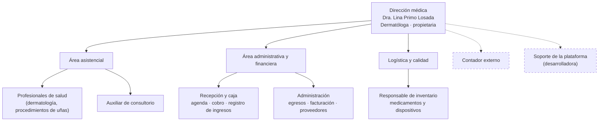

| Área | Cargos | Responsabilidades | Se relaciona con |
| --- | --- | --- | --- |
| **Dirección médica** | Dermatóloga propietaria | Atención especializada, decisiones financieras y de servicios, responsable ante la habilitación | Todas las áreas; contador externo |
| **Área asistencial** | Profesionales de salud, auxiliar | Consultas y procedimientos, uso de insumos, historia clínica | Recepción (pacientes que llegan), logística (insumos) |
| **Administrativa y financiera** | Recepción y caja, administración | Agenda, cobro, registro de ingresos y egresos, facturación electrónica, pagos a proveedores | Asistencial (servicio prestado), dirección (reportes), contador (soportes) |
| **Logística y calidad** | Responsable de inventario | Recibir insumos, registrar lotes y vencimientos, dar de baja, atender alertas | Asistencial (consumo), administración (compras), dirección (alertas) |
| **Externos** | Contador, desarrolladora de la plataforma | Obligaciones tributarias; mantenimiento y soporte de la plataforma | Dirección y administración |

En una microempresa una misma persona suele tener varios roles. Por ejemplo, la recepcionista puede también
registrar egresos y la auxiliar puede manejar el inventario.

## 4. Activos de información

**Esquema de clasificación usado**

- **Confidencialidad** (escala interna): *Pública* · *Uso interno* · *Confidencial* · *Restringida*.
- **Datos personales** (Ley 1581 de 2012): *público* · *semiprivado* · *privado* · *sensible*. Los datos de
  salud son **sensibles** (art. 5): requieren autorización expresa y acceso restringido.
- **Criticidad C-I-D**: confidencialidad, integridad y disponibilidad, cada una Alta (A), Media (M) o Baja (B).

| ID | Activo | Contenido | Formato y ubicación | Propietario | Clasificación | C-I-D | Datos personales |
| --- | --- | --- | --- | --- | --- | --- | --- |
| AI-01 | **Registro de ingresos** | Atenciones cobradas: fecha, servicio, paciente (cédula, nombres, apellidos), profesional, valor, forma de pago, comisión, factura | Google Sheets · libro de finanzas · `INGRESOS I SEMESTRE` y `INGRESOS II SEMESTRE` | Dirección médica | **Restringida** | A-A-A | **Sí, sensible.** La cédula y el nombre junto al procedimiento dermatológico revelan información de salud |
| AI-02 | **Registro de egresos** | Gastos: fecha, concepto contable, descripción, valor, tipo y número de soporte | Google Sheets · libro de finanzas · `EGRESOS I SEMESTRE` y `EGRESOS II SEMESTRE` | Dirección médica | **Confidencial** | M-A-M | Sí, semiprivado: nombres de proveedores y personas naturales en las descripciones |
| AI-03 | **Catálogo contable** | Servicios con código y nombre, profesionales, formas de pago, conceptos de gasto y tipos de soporte | Google Sheets · libro de finanzas · `CUENTAS CONTABLES` | Administración | **Uso interno** | B-A-A | Sí, público: nombres de los profesionales |
| AI-04 | **Inventario de medicamentos y dispositivos** | 262 registros en 26 columnas: producto, lote, cantidad, vencimiento, registro INVIMA, clasificación de riesgo, ubicación, estado y bajas | Google Sheets · libro de inventario aparte · `INVENTARIO` | Responsable de inventario | **Uso interno** | B-A-A | No (solo el nombre del responsable) |
| AI-05 | **Inventario histórico original** | Las 6 hojas de Excel anteriores a la migración (medicamentos, dispositivos, botiquín, kit de derrames) | Google Sheets convertido del Excel original · solo lectura | Responsable de inventario | **Uso interno** | B-A-B | No |
| AI-06 | **Historias clínicas** | Anamnesis, diagnóstico, tratamiento, consentimientos informados, fotografías clínicas | Sistema o archivo propio del consultorio (por validar), fuera de la plataforma | Dirección médica | **Restringida** | A-A-A | **Sí, sensible.** Retención mínima de 15 años (Resolución 839 de 2017) |
| AI-07 | **Facturas electrónicas** | Facturas emitidas a pacientes que la solicitan: datos del adquirente, servicio y valor | Software de facturación electrónica habilitado ante la DIAN (por validar) | Administración | **Confidencial** | M-A-M | Sí, privado: cédula o NIT, nombre, correo |
| AI-08 | **Tablero financiero** | Agregados: ingresos, egresos, margen, caja, ingresos por servicio y gastos por concepto | Calculado en la plataforma; no se guarda | Dirección médica | **Confidencial** | M-M-M | No: solo cifras agregadas |
| AI-09 | **Alertas de vencimiento** | Correo diario con los insumos que empeoraron y la lista de destinatarios | Gmail · propiedad `CORREOS_ALERTA` | Responsable de inventario | **Uso interno** | B-M-M | Sí, privado: correos del personal |
| AI-10 | **Código fuente de la plataforma** | Lógica de negocio, interfaz y configuración | Google Apps Script y repositorio GitHub con licencia propietaria | Desarrolladora | **Confidencial** | M-A-M | No. Los IDs de los libros y los correos van en propiedades del script, fuera del código |

Los activos más críticos son AI-01 y AI-06: tienen datos sensibles de salud. Hoy el AI-01 se protege con
permisos de Google Drive sobre el libro de finanzas, separado del libro de inventario, pero no tiene registro
de quién lo consulta o lo edita.

## 5. Mapa de procesos (BPM)

### 5.1 Mapa de procesos general

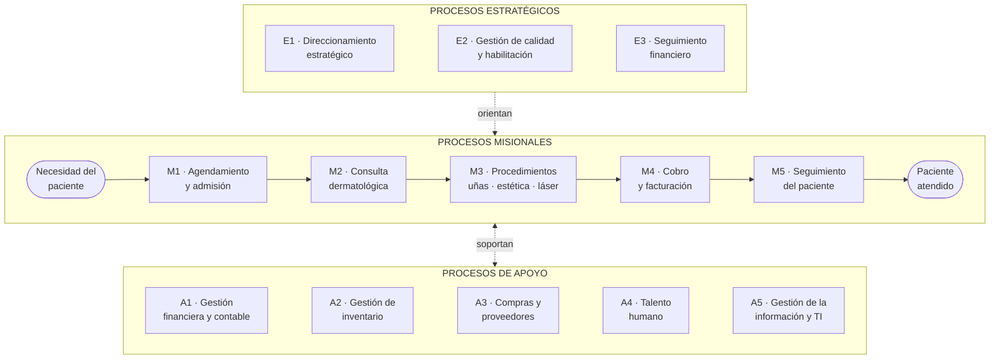

| Tipo | Proceso | Objetivo | Soporte actual |
| --- | --- | --- | --- |
| Estratégico | E1 · Direccionamiento estratégico | Definir servicios, precios y metas | Decisiones de la dirección; sin formalizar |
| Estratégico | E2 · Gestión de calidad y habilitación | Cumplir la Resolución 3100 y la seguridad del paciente | Inventario trazable en la plataforma; el resto es documental (por validar) |
| Estratégico | E3 · Seguimiento financiero | Revisar margen, caja y tendencias | Tablero financiero de la plataforma |
| Misional | M1 · Agendamiento y admisión | Asignar la cita y recibir al paciente | Doctoralia, teléfono y WhatsApp (por validar) |
| Misional | M2 · Consulta dermatológica | Diagnosticar y definir el tratamiento | Historia clínica (por validar) |
| Misional | M3 · Procedimientos | Hacer procedimientos de uñas, estéticos y con láser | Insumos del inventario |
| Misional | M4 · Cobro y facturación | Cobrar, registrar el ingreso y emitir la factura | Plataforma (ingresos), datáfono BOLD, software de facturación |
| Misional | M5 · Seguimiento del paciente | Controles y continuidad del tratamiento | Búsqueda de paciente en la plataforma; agenda |
| Apoyo | A1 · Gestión financiera y contable | Registrar egresos y entregar soportes al contador | Plataforma (egresos) y hojas |
| Apoyo | A2 · Gestión de inventario | Mantener insumos vigentes y trazables | Plataforma (logística) y alertas por correo |
| Apoyo | A3 · Compras y proveedores | Comprar medicamentos, dispositivos y suministros | Manual; el pago queda como egreso |
| Apoyo | A4 · Talento humano | Vincular y pagar al personal | Manual; los pagos quedan como egresos |
| Apoyo | A5 · Gestión de la información y TI | Mantener la plataforma, los accesos y los datos | Google Workspace y soporte externo |

### 5.2 Modelos BPMN de los procesos principales

Los diagramas siguen la notación BPMN 2.0: carriles (*lanes*) por rol, evento de inicio `( )`, evento de fin
`(( ))`, tareas en rectángulo y compuertas exclusivas en rombo.

#### M1 a M4 · Atención y cobro al paciente (misional)

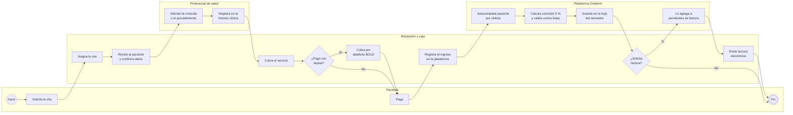

#### A1 · Registro de egresos (apoyo)

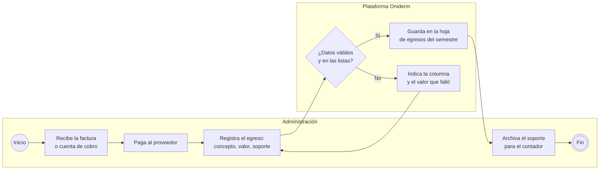

#### A2 · Ingreso de insumos al inventario (apoyo)

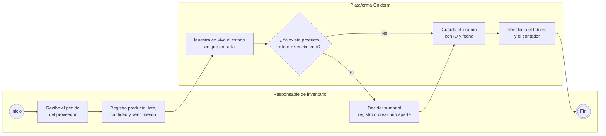

#### A2 · Vigilancia de vencimientos y bajas (apoyo)

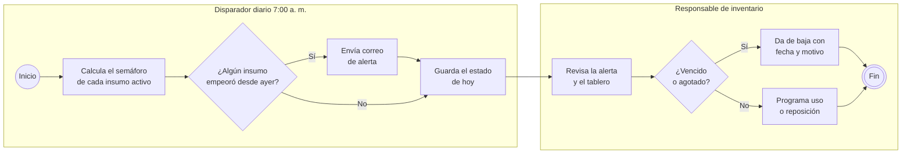

#### E3 · Seguimiento financiero (estratégico)

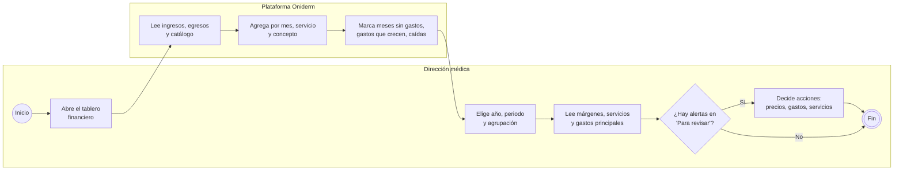

## 6. Mapa de capacidades (Business Capabilities)

Una capacidad es **qué** sabe hacer la organización, sin importar cómo ni con qué. El color indica qué tan
soportada está hoy:

- 🟢 **Soportada:** la plataforma la automatiza.
- 🟡 **Parcial:** hay herramienta, pero con pasos manuales o datos incompletos.
- 🔴 **Manual:** depende de las personas, papel o mensajes.
- ⚪ **Por validar:** existe, pero no se conoce cómo se soporta.

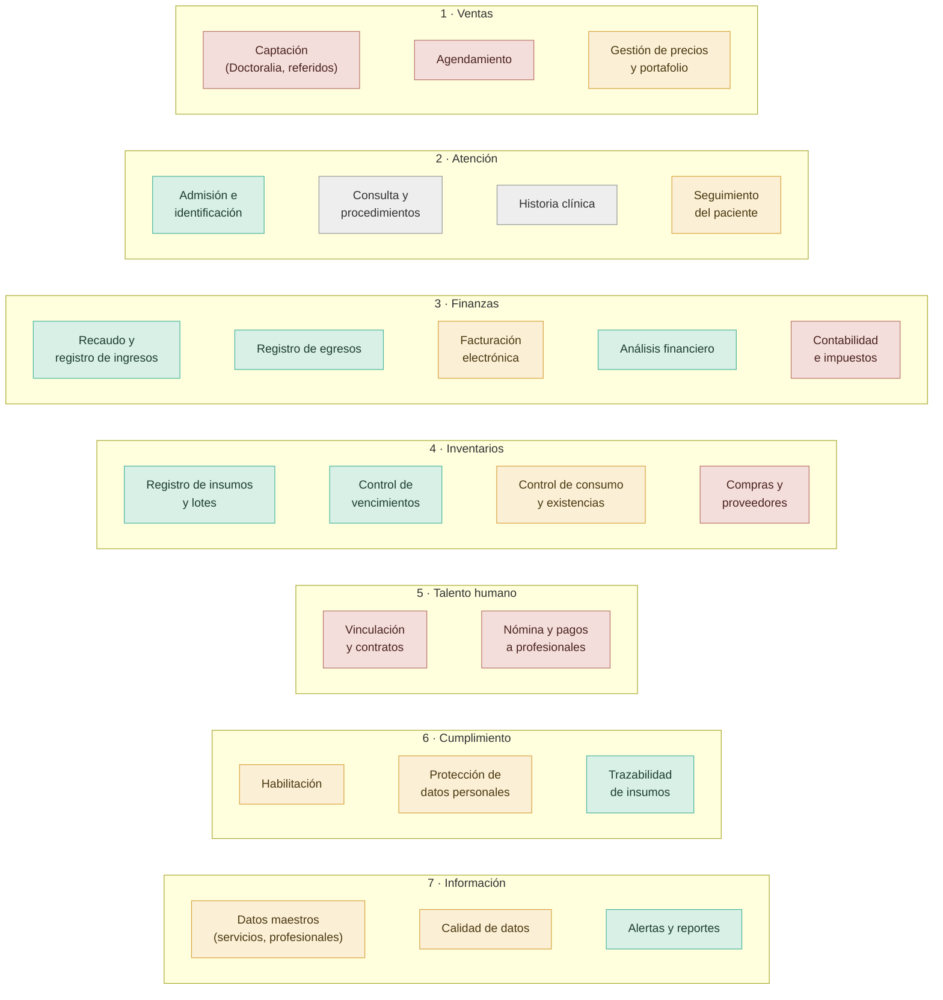

| Capacidad (nivel 1) | Capacidad (nivel 2) | Estado | Cómo se soporta hoy |
| --- | --- | :-: | --- |
| **Ventas** | Captación de pacientes | 🔴 | Perfil en Doctoralia y referidos; sin registro de origen del paciente |
| | Agendamiento | 🔴 | Doctoralia, teléfono o WhatsApp (por validar); no conectado con la plataforma |
| | Gestión de precios y portafolio | 🟡 | Catálogo de servicios con código en `CUENTAS CONTABLES`; sin lista de precios formal |
| **Atención al cliente** | Admisión e identificación | 🟢 | Cédula obligatoria, autocompletado y normalización de nombres |
| | Consulta y procedimientos | ⚪ | Por validar |
| | Historia clínica | ⚪ | Sistema o archivo externo (por validar) |
| | Seguimiento del paciente | 🟡 | Búsqueda por nombre o cédula con historial de atenciones; los registros anteriores a v1.1 no tienen cédula |
| **Gestión financiera** | Recaudo y registro de ingresos | 🟢 | Plataforma: un formulario, comisión automática, validación y guardado sin filas a medias |
| | Registro de egresos | 🟢 | Plataforma: concepto contable y soporte |
| | Facturación electrónica | 🟡 | La factura se emite en otro sistema; la plataforma solo lleva el número y la lista de pendientes |
| | Análisis financiero | 🟢 | Tablero con comparación anual, agrupación por periodo y lecturas en lenguaje natural |
| | Contabilidad e impuestos | 🔴 | Contador externo con los soportes |
| **Gestión de inventarios** | Registro de insumos y lotes | 🟢 | Formulario con autocompletado y detección de duplicados |
| | Control de vencimientos | 🟢 | Semáforo de 6 estados y alerta diaria solo cuando algo empeora |
| | Control de consumo y existencias | 🟡 | La cantidad se corrige a mano; no hay descuento de unidades por uso |
| | Compras y proveedores | 🔴 | Manual; la compra no se relaciona con el lote |
| **Gestión de talento humano** | Vinculación y contratos | 🔴 | Manual |
| | Nómina y pagos a profesionales | 🔴 | Manual; solo aparece como egreso |
| **Cumplimiento** | Habilitación | 🟡 | El inventario es trazable; el resto de estándares no está sistematizado |
| | Protección de datos | 🟡 | Libros separados y permisos de Drive; sin auditoría de accesos ni registro de autorizaciones |
| | Trazabilidad de insumos | 🟢 | Nada se borra; bajas con fecha y motivo |
| **Gestión de la información** | Datos maestros | 🟡 | Dos fuentes para las listas (catálogo y validación de cada hoja) |
| | Calidad de datos | 🟡 | Validaciones al escribir y avisos al leer; sin indicadores |
| | Alertas y reportes | 🟢 | Correo diario de vencimientos y tablero de logística |

## 7. Stakeholders

| ID | Parte interesada | Tipo | Interés en la arquitectura | Influencia | Interés | Estrategia |
| --- | --- | --- | --- | :-: | :-: | --- |
| SH-01 | Dra. Lina Primo Losada (directora y propietaria) | Interno | Rentabilidad, seguridad del paciente, cumplimiento, tiempo | **Alta** | **Alto** | Gestionar de cerca: aprueba cada cambio |
| SH-02 | Profesionales de salud | Interno | Agenda organizada, insumos disponibles, pagos claros | Media | Alto | Mantener informados |
| SH-03 | Recepción y caja | Interno | Registro rápido, menos errores, factura sin reprocesos | Baja | **Alto** | Mantener informados e involucrar en pruebas |
| SH-04 | Responsable de inventario | Interno | Saber qué vence, registrar fácil, estar listo para visitas | Baja | **Alto** | Mantener informados e involucrar en pruebas |
| SH-05 | Pacientes | Externo | Atención ágil, factura cuando la pide, privacidad de sus datos | Media | Medio | Mantener satisfechos |
| SH-06 | Secretaría Distrital de Salud de Bogotá | Regulador | Cumplimiento de la habilitación (Resolución 3100 de 2019) | **Alta** | Medio | Mantener satisfechos: evidencia lista para visitas |
| SH-07 | INVIMA | Regulador | Medicamentos y dispositivos con registro sanitario vigente | **Alta** | Bajo | Mantener satisfechos |
| SH-08 | DIAN | Regulador | Facturación electrónica y obligaciones tributarias | **Alta** | Bajo | Mantener satisfechos |
| SH-09 | Superintendencia de Industria y Comercio | Regulador | Tratamiento de datos personales (Ley 1581 de 2012) | **Alta** | Bajo | Mantener satisfechos |
| SH-10 | Contador externo | Externo | Soportes completos y ordenados | Media | Medio | Mantener informado |
| SH-11 | Proveedores de medicamentos y dispositivos | Externo | Pedidos y pagos oportunos | Baja | Bajo | Monitorear |
| SH-12 | BOLD (datáfono) | Proveedor | Transacciones con tarjeta; cobra la comisión | Baja | Bajo | Monitorear |
| SH-13 | Google (Workspace) | Proveedor tecnológico | Plataforma donde corre todo: hojas, scripts y correo | Media | Bajo | Monitorear: dependencia de un solo proveedor |
| SH-14 | Doctoralia | Proveedor | Perfil público y canal de captación de pacientes | Baja | Bajo | Monitorear |
| SH-15 | Desarrolladora de la plataforma | Externo | Mantenimiento, evolución y propiedad intelectual del código | Media | Alto | Mantener informada |

**Matriz poder-interés**

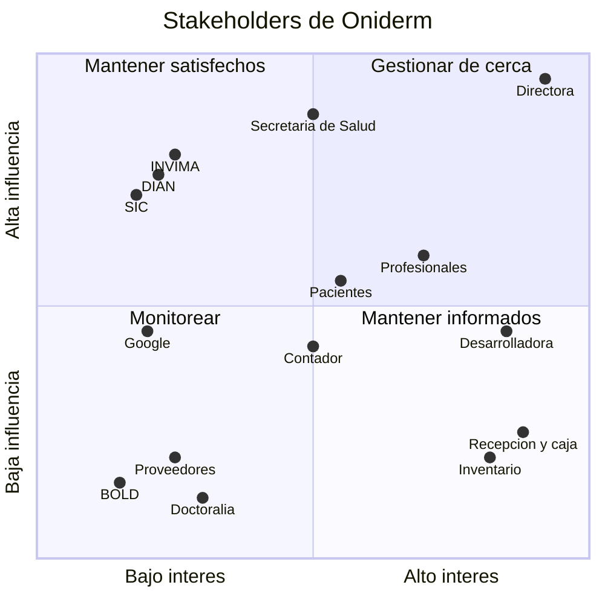

## 8. Arquitectura de Negocio AS-IS por dominio

Este documento describe cómo opera Oniderm hoy desde los cuatro dominios de arquitectura de TOGAF: **negocio,
datos, aplicaciones y tecnología**. Para cada dominio indica qué existe, cómo apoya la misión y los objetivos
estratégicos y qué brechas tiene.

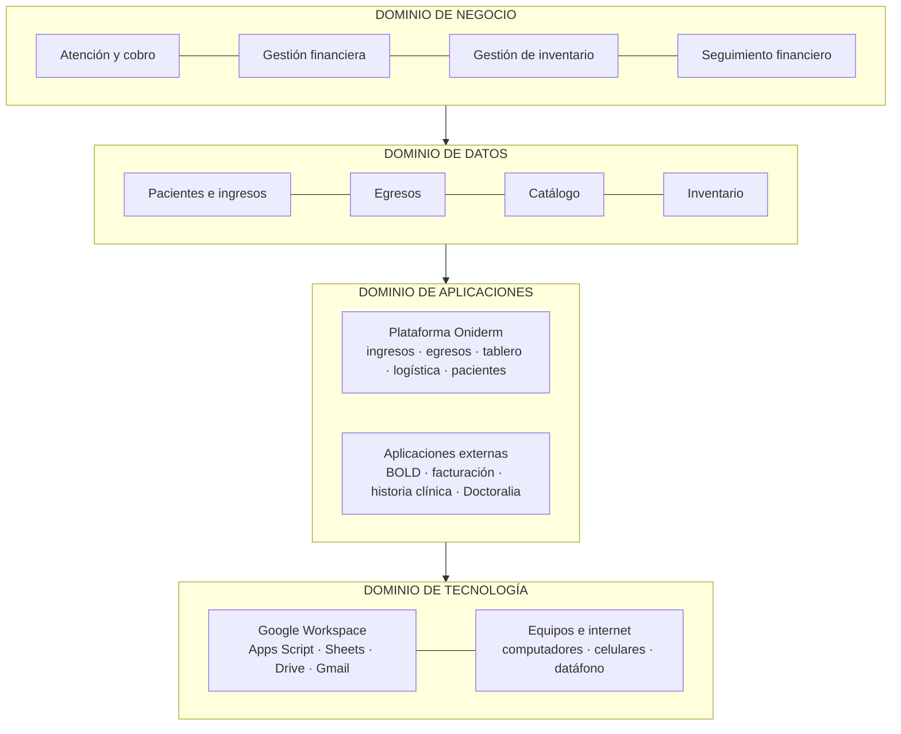

### 8.1 Dominio de negocio

**Estructura organizacional.** Microempresa con una dirección médica que concentra las decisiones, un área
asistencial, un área administrativa y financiera y una función de logística (ver el
[organigrama](#3-organigrama)). Varias personas cumplen más de un rol.

**Servicios.** Consulta de dermatología clínica, consulta especializada en uñas, dermatología estética,
procedimientos de uñas y láser dermocosmético. Todos se cobran al paciente particular.

**Cómo se ejecutan hoy los procesos**

| Proceso | Cómo opera hoy | Qué cambió con la plataforma | Qué sigue siendo manual |
| --- | --- | --- | --- |
| M1 · Agendamiento | Doctoralia, teléfono o WhatsApp (por validar) | Nada | Todo el proceso |
| M2-M3 · Consulta y procedimientos | El profesional atiende y registra en la historia clínica | Nada | Historia clínica fuera de la plataforma |
| M4 · Cobro y facturación | Recepción cobra, registra el ingreso y emite la factura si la piden | Un formulario con cédula, servicio, profesional y pago; comisión calculada; lista de facturas pendientes | La factura se emite en otro sistema y su número se copia a mano |
| A1 · Egresos | Administración paga y registra el gasto con su soporte | Formulario con validación contra listas | Soportes físicos o en otros archivos |
| A2 · Inventario | Logística registra lo que llega y da de baja lo vencido o agotado | Semáforo, alertas diarias, duplicados, trazabilidad | El consumo diario no descuenta unidades |
| E3 · Seguimiento financiero | La dirección revisa el tablero | Tablero con comparación anual y alertas | Las decisiones no quedan registradas |

**Capacidades.** De 24 capacidades de nivel 2, 8 están soportadas, 8 son parciales, 6 son manuales y 2 están
por validar (ver el [mapa de capacidades](#6-mapa-de-capacidades-business-capabilities)). Las capacidades
financieras y de inventario son las más maduras. Las de ventas, talento humano y la parte clínica son las menos.

**Actores.** Directora, profesionales, recepción y caja, responsable de inventario, pacientes, contador y los
reguladores (ver los [stakeholders](#7-stakeholders)).

### 8.2 Dominio de datos

**Entidades y relaciones actuales**

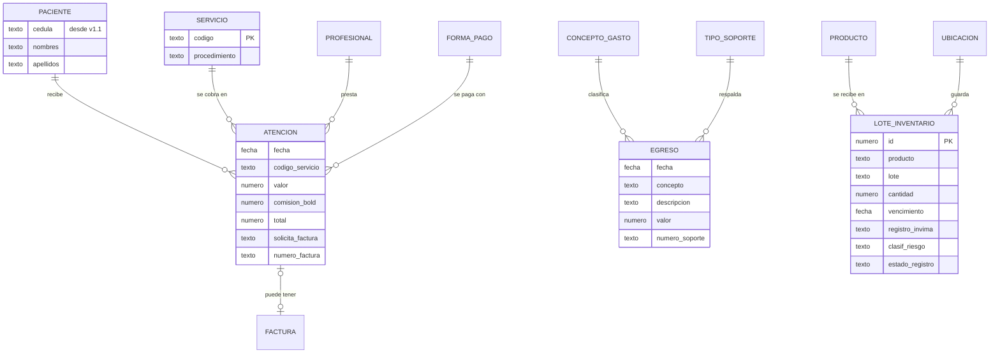

Así se guardan físicamente hoy: `PACIENTE` no es una tabla propia, son columnas dentro de cada `ATENCION`
(una fila de la hoja de ingresos). `SERVICIO`, `PROFESIONAL`, `FORMA_PAGO`, `CONCEPTO_GASTO` y `TIPO_SOPORTE`
son listas en `CUENTAS CONTABLES`. `FACTURA` vive en el sistema de facturación; en la plataforma solo está su
número. `ATENCION` y `EGRESO` no tienen identificador propio.

**Flujos de información**

| Origen | Información | Destino | Medio | Frecuencia |
| --- | --- | --- | --- | --- |
| Paciente | Cédula, nombres, servicio, forma de pago | Recepción → hoja de ingresos | Formulario de la plataforma | Cada atención |
| Datáfono BOLD | Pago aprobado y comisión | Recepción → hoja de ingresos | Manual: se elige la forma de pago y la comisión se calcula | Cada pago con tarjeta |
| Software de facturación | Número de factura | Hoja de ingresos | Manual: se copia en la lista de pendientes | Cada factura |
| Proveedor | Factura de compra | Administración → hoja de egresos | Formulario de la plataforma | Cada gasto |
| Proveedor | Producto, lote y vencimiento | Logística → hoja de inventario | Formulario de la plataforma | Cada pedido |
| Catálogo contable | Servicios, profesionales, listas | Formularios y tablero | Lectura automática con caché de 6 h | Cada carga |
| Hojas de ingresos y egresos | Movimientos | Tablero financiero → dirección | Cálculo al vuelo | Cada consulta |
| Hoja de inventario | Estado de cada insumo | Correo de alertas → dirección y logística | Disparador automático | Diario, solo si algo empeora |
| Hojas de finanzas | Soportes y movimientos | Contador externo | Manual (por validar) | Mensual (por validar) |
| Excel original de inventario | 262 registros | Hoja `INVENTARIO` | Migración automática única | Una vez |

**Dominios de datos.** El detalle por dominio de datos (maestros, finanzas, pacientes, logística, analítica y
notificaciones), con sus productos de datos y controles de calidad, está en la sección
[Arquitectura de datos · As-Is por dominios](README.md#arquitectura-de-datos--as-is-por-dominios) del README.
Este punto se desarrollará completo en el Punto 2.

**Calidad de datos encontrada**

| Problema | Dónde | Alcance |
| --- | --- | --- |
| Información incompleta | Inventario: fecha de vencimiento no usable | 145 de 262 registros (55 %) antes de la migración |
| Información inconsistente | Inventario: fecha de ingreso en 8 formatos; fecha de vencimiento partida en 3 columnas | 262 registros |
| Información inconsistente | Finanzas: valores como texto (`$ 210.000,00`), códigos `CO1` en vez de `C01` | Histórico de ingresos |
| Información incompleta | Ingresos anteriores a v1.1 sin cédula; el paciente es texto libre | Todo el histórico |
| Duplicidad | Listas en dos lugares: catálogo y validación de cada hoja | Profesionales, formas de pago, conceptos, soportes |
| Archivos aislados | Historia clínica y facturación fuera de la plataforma, sin conexión | Todos los pacientes |

### 8.3 Dominio de aplicaciones

**Inventario de aplicaciones**

| Aplicación | Función | Área usuaria | Tipo |
| --- | --- | --- | --- |
| **Plataforma Oniderm · Ingresos y pacientes** | Registro de atenciones, búsqueda de pacientes, edición y facturas pendientes | Recepción y caja | Desarrollo propio (Google Apps Script) |
| **Plataforma Oniderm · Egresos** | Registro de gastos por concepto contable | Administración | Desarrollo propio |
| **Plataforma Oniderm · Tablero financiero** | Ingresos, egresos, margen, caja, servicios y gastos | Dirección | Desarrollo propio |
| **Plataforma Oniderm · Logística** | Inventario con semáforo, registro de insumos, bajas y alertas diarias | Responsable de inventario, dirección | Desarrollo propio |
| Google Sheets | Almacenamiento de los dos libros (finanzas e inventario) y edición directa cuando hace falta | Todas | SaaS |
| Gmail | Envío del correo diario de alertas | Dirección, logística | SaaS |
| Google Drive | Archivos, logo y permisos de los libros | Dirección | SaaS |
| BOLD | Cobro con tarjeta débito y crédito | Recepción y caja | SaaS y datáfono |
| Software de facturación electrónica | Emisión de facturas ante la DIAN | Administración | SaaS (por validar) |
| Historia clínica | Registro clínico de cada paciente | Profesionales | Por validar |
| Doctoralia | Perfil público, reseñas y posible agenda en línea | Dirección, recepción | SaaS (uso de agenda por validar) |
| WhatsApp | Comunicación con pacientes y confirmación de citas | Recepción | Mensajería (por validar) |

**Mapa de integraciones actual**

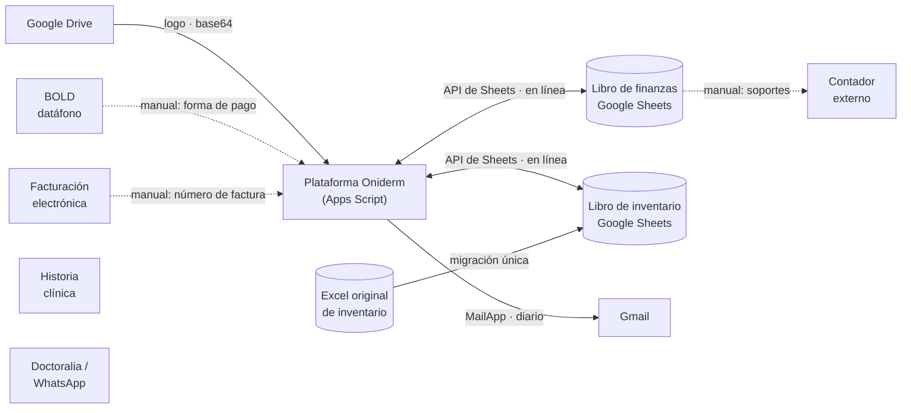

Línea continua: integración automática. Línea punteada: la información pasa por una persona. Sin línea:
aplicación aislada, sin intercambio.

**Problemas identificados**

- **Falta de integración:** facturación, BOLD, historia clínica y agenda no se conectan con la plataforma. El
  número de factura y la forma de pago se digitan.
- **Procesos manuales:** agendamiento, compras, nómina y entrega de soportes al contador.
- **Dependencia de hojas de cálculo:** los datos viven en Google Sheets. La plataforma les da reglas y
  validaciones, pero cualquier persona con permiso puede editar la hoja directamente.
- **Sistemas duplicados:** las listas de servicios y profesionales están en dos lugares.

### 8.4 Dominio de tecnología

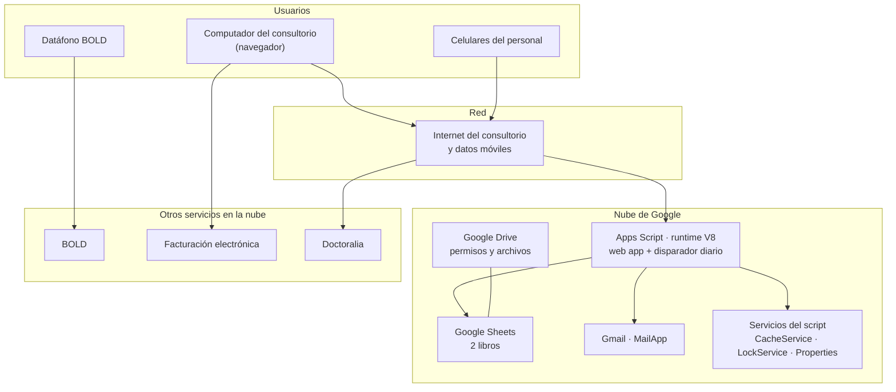

**Inventario tecnológico**

| Componente | Detalle actual |
| --- | --- |
| Servidores | Ninguno propio. La plataforma corre en la infraestructura de Google (sin servidor que administrar) |
| Computadores | Equipos del consultorio con navegador web (cantidad y estado por validar) |
| Dispositivos móviles | Celulares del personal. La plataforma es responsive y funciona en celular |
| Redes | Internet del consultorio y datos móviles (proveedor y plan por validar) |
| Bases de datos | Google Sheets como almacenamiento: libro de finanzas y libro de inventario |
| Servicios en la nube | Google Apps Script, Sheets, Drive y Gmail; BOLD; facturación electrónica; Doctoralia |
| Seguridad | Acceso con cuenta de Google y permisos de Drive por libro; configuración sensible en propiedades del script; escritura con candado |
| Costo de infraestructura | $0 mensuales para la plataforma (dentro de la cuenta de Google) |

**Riesgos tecnológicos observados**

| Riesgo | Descripción |
| --- | --- |
| Dependencia de un proveedor | Datos, lógica y correo dependen de Google. Un cambio en sus cuotas o políticas afecta toda la operación |
| Falta de respaldo formal | Solo existe el historial de versiones de Sheets; no hay copias programadas fuera de Google |
| Seguridad | Sin doble factor obligatorio ni registro de accesos al libro con datos sensibles (por validar) |
| Límites de la plataforma | Cuotas de Apps Script (tiempo de ejecución, correos diarios) y desempeño de Sheets cuando crezcan las filas |
| Continuidad | Si falla el internet del consultorio, no se puede registrar (no hay modo sin conexión) |

### 8.5 Cómo el AS-IS apoya la misión y los objetivos

| Objetivo | Capacidades | Procesos | Aplicaciones | Datos | Aporte hoy |
| --- | --- | --- | --- | --- | --- |
| OE1 · Salud financiera | Recaudo, egresos, análisis financiero | M4, A1, E3 | Ingresos, egresos, tablero | AI-01, AI-02, AI-03, AI-08 | **Alto.** La dirección ve margen y caja sin consolidar a mano |
| OE2 · Seguridad del paciente | Control de vencimientos, trazabilidad | A2 | Logística, Gmail | AI-04, AI-09 | **Alto.** Salieron a la luz 31 productos vencidos y hoy hay alerta diaria |
| OE3 · Habilitación | Habilitación, trazabilidad | E2, A2 | Logística | AI-04, AI-05 | **Medio.** Inventario listo para auditoría; otros estándares fuera del sistema |
| OE4 · Experiencia del paciente | Admisión, recaudo, facturación | M1, M4, M5 | Ingresos y pacientes | AI-01, AI-07 | **Medio.** Cobro ágil y facturas pendientes visibles; agenda y factura siguen aparte |
| OE5 · Protección de datos | Protección de datos | A5 | Google Drive | AI-01, AI-06, AI-07 | **Bajo.** Hay separación de libros, pero no hay auditoría ni registro de autorizaciones |
| OE6 · Crecimiento | Precios y portafolio, análisis financiero | E1, E3 | Tablero | AI-01, AI-03 | **Medio.** Se sabe qué servicios generan más, pero no de dónde llegan los pacientes |

### 8.6 Brechas del AS-IS

Estas brechas son el insumo para la arquitectura objetivo (TO-BE) y el análisis de brechas del Punto 5:

| Dominio | Brecha | Objetivo afectado |
| --- | --- | --- |
| Negocio | Agendamiento y seguimiento de pacientes fuera del sistema | OE4, OE6 |
| Negocio | Compras y consumo de insumos sin relación con el inventario | OE1, OE2 |
| Negocio | Misión, visión y procesos no formalizados | Todos |
| Datos | No existe un maestro de pacientes; el histórico no tiene cédula | OE4, OE5 |
| Datos | Movimientos financieros sin identificador ni bitácora de cambios | OE1, OE5 |
| Datos | Listas maestras con dos fuentes | OE1 |
| Aplicaciones | Facturación, BOLD e historia clínica sin integración | OE1, OE4 |
| Aplicaciones | Edición directa en las hojas sin pasar por las reglas de la plataforma | OE1, OE3 |
| Tecnología | Sin respaldo formal fuera de Google ni registro de accesos | OE5 |
| Tecnología | Dependencia total de un proveedor y del internet del consultorio | Todos |
