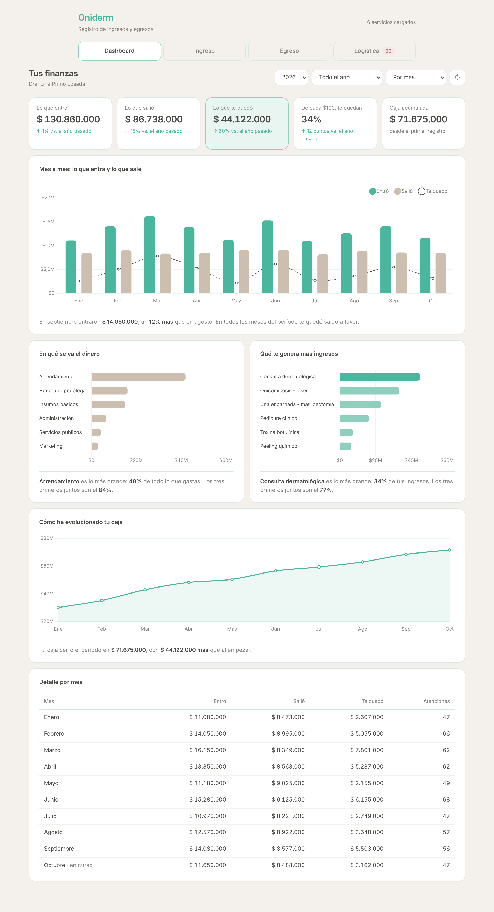
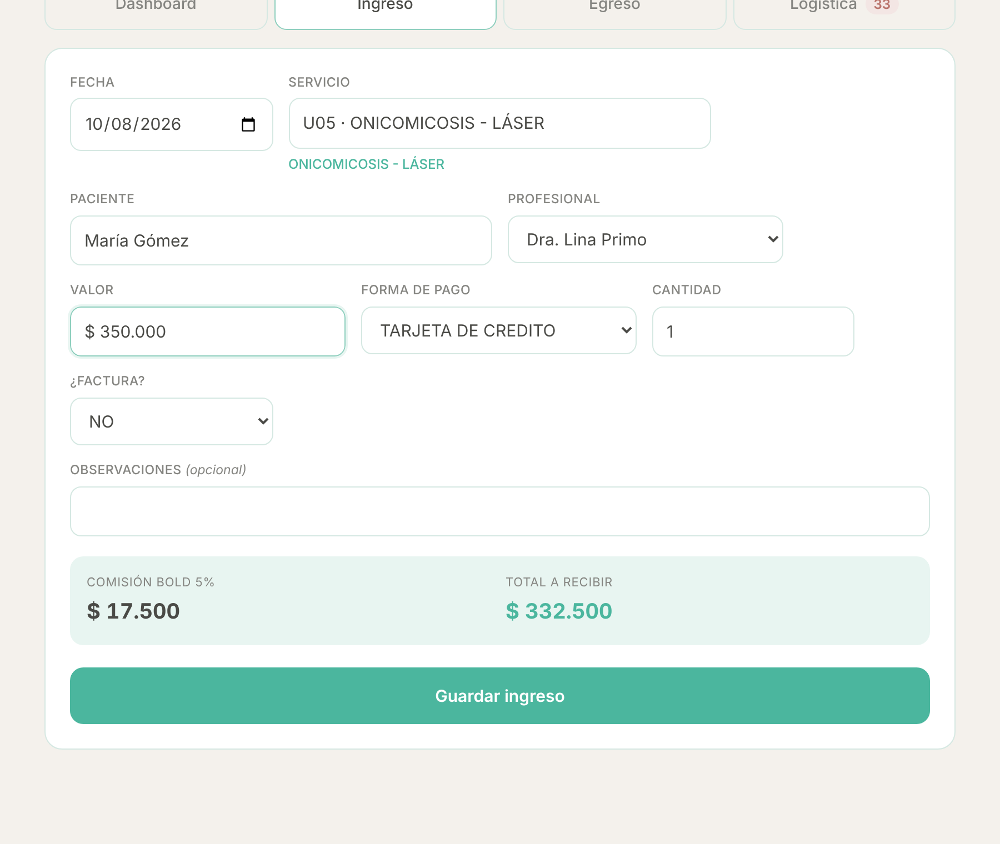
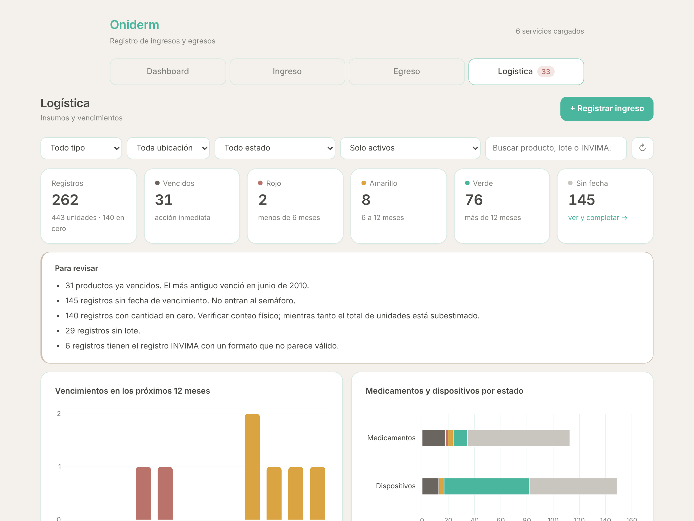
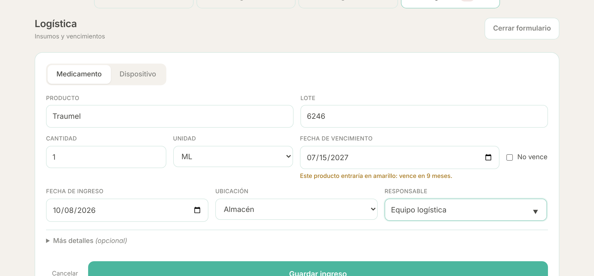
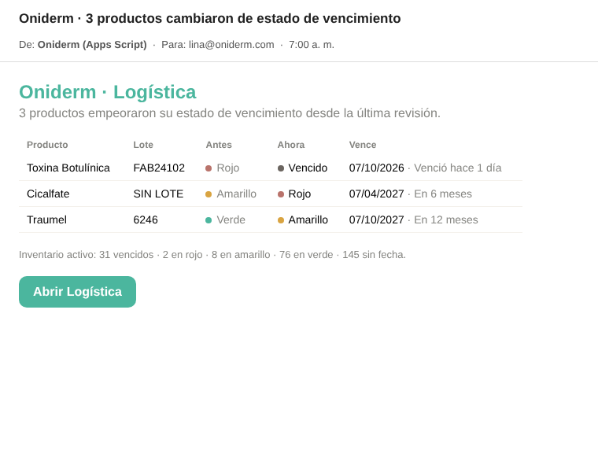
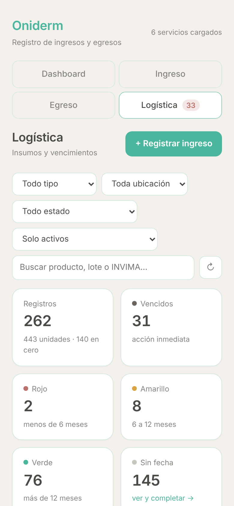
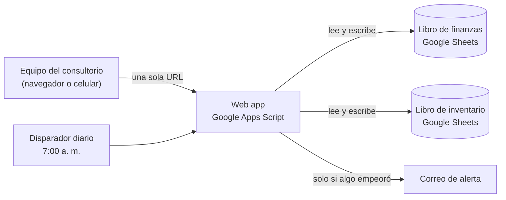
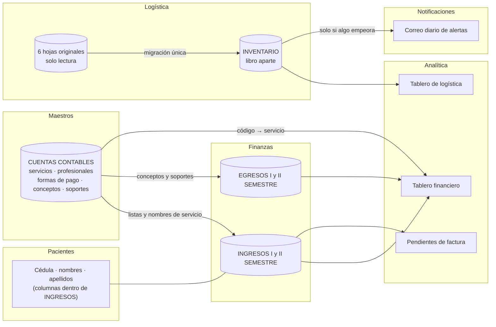

<div align="center">

# Oniderm · Gestión financiera y logística

**Web app a medida para un consultorio dermatológico en Colombia.**
Registro de ingresos y egresos, tablero financiero e inventario de medicamentos con semáforo de vencimientos,
todo en una sola interfaz construida sobre Google Workspace.


[](LICENSE)



</div>

---

## El reto

Oniderm es el consultorio de la Dra. Lina Primo Losada, especialista en dermatología y uñas. Toda su operación
vivía en hojas de cálculo que el equipo llenaba a mano:

- **Finanzas.** Cuatro hojas por año (ingresos y egresos por semestre) con fechas en varios formatos, valores
  escritos como texto (`$ 210.000,00`), códigos de servicio mal digitados (`CO1` en vez de `C01`) y listas
  desplegables que se rompían y bloqueaban el registro.
- **Inventario.** Un Excel de 6 hojas para medicamentos y dispositivos médicos donde la fecha de vencimiento estaba
  partida en tres columnas (día, mes y año). **El 55 % de los registros no tenía una fecha de vencimiento utilizable**
  y nadie sabía qué estaba vencido.

Para un consultorio habilitado esto no es solo incómodo: es un riesgo sanitario y regulatorio.

## La solución

Una **web app única** con cuatro pestañas, publicada desde Google Apps Script. No hay servidores que pagar ni que
mantener: los datos siguen en Google Sheets, donde el equipo ya trabajaba, y la app les pone encima una interfaz
clara, reglas de negocio y alertas.

| | |
| --- | --- |
|  |  |
| **Registro de ingresos y egresos** con cálculo automático de la comisión del datáfono. | **Inventario con semáforo** de vencimientos, alertas y acciones por producto. |

## Funcionalidades

### 💰 Finanzas
- **Registro de ingresos:** búsqueda de servicios por código o nombre, formato de pesos mientras se escribe y
  **cálculo automático de la comisión BOLD (5 %)** cuando el pago es con tarjeta.
- **Pacientes normalizados:** cédula, nombres y apellidos separados y obligatorios, con mayúsculas corregidas
  y autocompletado cuando la cédula ya existe.
- **Factura pendiente:** búsqueda de pacientes (nombre en cualquier orden o cédula), lista de ingresos sin número
  de factura y edición de un ingreso ya guardado sin abrir la hoja de cálculo.
- **Registro de egresos** por concepto contable, con soporte y número de soporte.
- Cada movimiento se guarda en la hoja del semestre correcto según su fecha, con mes y año calculados.
- **Tablero financiero:** lo que entró, lo que salió, margen y caja acumulada, comparados con el año anterior.
  Se filtra por año, semestre o trimestre, y se **agrupa por mes, trimestre, semestre o año**.
  Incluye gráficos mes a mes, en qué se va el dinero, qué servicios generan más ingresos y cómo evoluciona la caja.
- **Lecturas en lenguaje natural** bajo cada gráfico (*"Arrendamiento es lo más grande: 48 % de todo lo que gastas"*)
  y una sección **"Para revisar"** que detecta meses sin gastos registrados, gastos que crecen más rápido que los
  ingresos o caídas de ingresos.

### 📦 Logística
- **Semáforo de 6 estados** calculado cada día contra la fecha de hoy (hora de Bogotá): vencido, rojo (menos de
  6 meses), amarillo (6 a 12 meses), verde, sin fecha y no vence.
- **Registro de insumos** con autocompletado de productos ya conocidos. El formulario solo muestra los campos del
  tipo elegido (medicamento o dispositivo) y **avisa en vivo en qué estado entraría el producto** antes de guardarlo.
- **Detección de duplicados** (producto + lote + vencimiento): pregunta si se suma al registro existente o se crea
  uno aparte. Avisa, pero nunca bloquea.
- **Trazabilidad completa:** nunca se borra una fila. Los productos se marcan como *agotados* o *descartados* con
  fecha y motivo, que es lo que exige una visita de habilitación.
- **Contador en la pestaña** (`Logística 33`) visible desde cualquier parte de la app.
- **Alerta diaria por correo** a las 7 a. m., **solo cuando algún producto empeora** (verde → amarillo → rojo →
  vencido). Si nada cambia, no llega correo: un aviso diario idéntico deja de leerse en una semana.

<div align="center">

<br><br>

&nbsp;&nbsp;

</div>

## Resultados

Los números de la migración, con el inventario real del consultorio:

| | |
| --: | --- |
| **6 → 1** | hojas de inventario unificadas en una tabla limpia de 26 columnas, sin tocar los originales |
| **262** | registros migrados, con las cifras verificadas contra el diagnóstico inicial |
| **31** | productos vencidos que salieron a la luz, algunos desde 2010, entre ellos medicamentos de uso clínico |
| **145** | registros sin fecha que dejaron de ser un vacío silencioso: ahora tienen su propia tarjeta para completarlos |
| **$0** | costo mensual de infraestructura |

## Arquitectura



**Una interfaz, dos libros.** Finanzas e inventario son dominios con permisos distintos: el equipo de logística
puede trabajar el inventario sin ver la facturación. Se unificó la interfaz, no el almacenamiento.

### Decisiones técnicas

- **Columnas por encabezado, nunca por posición.** Si alguien agrega o mueve una columna en la hoja, nada se rompe.
  El código encuentra cada columna por su título, ignorando mayúsculas, tildes y espacios.
- **Lo que depende del tiempo no se guarda.** El semáforo, los días restantes y los totales se calculan al vuelo,
  porque guardados quedarían desactualizados al día siguiente. La única excepción es el último estado conocido, que se
  conserva para detectar qué cambió y avisar.
- **Concurrencia segura.** Toda escritura pasa por `LockService`, así dos personas registrando al mismo tiempo no se
  pisan la fila.
- **Rendimiento:** una sola lectura por hoja, agregación en el servidor (no se mandan miles de filas al navegador),
  tabla recortada a 150 filas con "ver más", y caché de 10 minutos que se invalida en cada escritura.
- **Tolerante a datos reales.** Fechas como `10-04-24`, `10 04 2024`, `2-04-25` o fecha nativa de Excel; valores como
  `$ 210.000,00`; lotes que Excel convirtió en fechas; listas desplegables que apuntan a rangos que ya no existen.
  Todo se interpreta, y lo que no se puede interpretar se reporta en vez de esconderse.
- **Guardado sin filas a medias.** Antes de escribir, cada valor se valida contra las listas desplegables de la hoja.
  Si Sheets rechaza una celda, se deshace lo escrito y el mensaje dice exactamente qué columna y qué valor falló.
- **Accesible y responsive.** Los estados nunca se comunican solo con color (punto + palabra), el diseño funciona en
  celular y la paleta respeta la identidad visual de la marca.

### Calidad de datos encontrada en el inventario

Parte del trabajo fue hacer el diagnóstico antes de escribir código. Las decisiones de diseño salieron de aquí:

| Problema | Alcance | Cómo se resolvió |
| --- | --: | --- |
| Fecha de vencimiento partida en 3 columnas | 262 registros | Se fusiona en una sola fecha y se rechazan combinaciones imposibles (30 de febrero, mes 19) |
| Año escrito como `X` o incompleto | 145 registros | Estado propio "Sin fecha", con botón para completarla desde la tabla |
| Año en 2 dígitos (`25`) | 104 registros | Normalizado a 4 dígitos |
| Registro INVIMA como `X` o vacío | 201 registros | El tipo (medicamento o dispositivo) es un dato propio, no se deduce del INVIMA |
| Columna de cantidad inexistente en dispositivos | 140 registros | Entran en 0, se avisa que el total de unidades está subestimado y se corrige desde la tabla |
| Fecha de ingreso en 8 formatos distintos | 262 registros | Se interpretan todos; el único ilegible queda reportado |

## Arquitectura de datos · As-Is por dominios

Oniderm es, en el fondo, una operación que vive de sus datos: cada atención genera un ingreso, cada compra un
egreso, cada insumo una fecha de vencimiento que vigilar. Por eso la arquitectura se describe por **dominios de
datos**. Cada dominio tiene sus entidades, quién las produce, quién las usa y qué controles de calidad tiene hoy.

Esta es la foto del estado actual (**As-Is**), no la ideal. Las brechas del final son el punto de partida del
To-Be.

### Mapa de dominios



### Inventario de dominios

| Dominio | Almacenamiento | Entidad principal y llave | Produce | Consume | Frecuencia |
| --- | --- | --- | --- | --- | --- |
| **Maestros** | Libro de finanzas · hoja `CUENTAS CONTABLES` | Servicio (`CODIGO`), más listas de profesionales, formas de pago, conceptos de gasto y soportes | Administración, a mano en la hoja | Formularios, validaciones de la hoja, tablero | Cuando cambia el portafolio o el equipo |
| **Finanzas · Ingresos** | Libro de finanzas · `INGRESOS I SEMESTRE` y `INGRESOS II SEMESTRE` | Atención cobrada. No hay ID: la fila se identifica con una huella `fecha + paciente + código + valor` | Recepción y caja, desde la app | Tablero financiero, búsqueda de pacientes, pendientes de factura | Cada atención |
| **Finanzas · Egresos** | Libro de finanzas · `EGRESOS I SEMESTRE` y `EGRESOS II SEMESTRE` | Gasto, sin ID | Administración, desde la app | Tablero financiero | Cada gasto |
| **Pacientes** | Columnas `CEDULA`, `NOMBRES` y `APELLIDOS` dentro de las hojas de ingresos (desde v1.1). Antes, solo `NOMBRE Y APELLIDO` en texto libre | Paciente (`CEDULA`, normalizada a solo dígitos) | Recepción, al registrar el ingreso | Autocompletado, búsqueda y edición | Cada atención |
| **Logística** | Libro de inventario aparte (`ID_LIBRO_INVENTARIO`) · hoja `INVENTARIO` de 26 columnas | Insumo por lote (`ID` consecutivo). Duplicado = `producto + lote + vencimiento` | Responsable de logística, desde la app | Tablero de logística, contador de la pestaña, alertas | Cada ingreso o baja de insumo |
| **Analítica** | Se calcula al vuelo, no se guarda. Caché de 6 h (catálogo) y 10 min (inventario) | Agregados por mes, servicio, concepto y estado | El servidor de Apps Script | Dirección del consultorio | Cada vez que se abre el tablero |
| **Notificaciones** | Columna `ULTIMO_ESTADO` en `INVENTARIO` y propiedad `CORREOS_ALERTA` | Cambio de estado de un insumo | Disparador diario de las 7 a. m. (hora de Bogotá) | Dirección y logística | Diaria, solo si algo empeoró |

### Productos de datos que existen hoy

| Producto | Origen | Qué entrega | Función |
| --- | --- | --- | --- |
| Resumen financiero | Ingresos + egresos + maestros | Ingreso neto de comisión, egreso, comisión BOLD y atenciones por mes; ingresos por servicio y gastos por concepto; avisos de calidad | `getResumen()` |
| Tablero de logística | Inventario | Conteo por estado del semáforo, vencimientos por mes, tabla priorizada y sección "Para revisar" | `getTableroInventario()` |
| Contador de logística | Inventario | Vencidos y rojos activos, en la pestaña | `getContadorLogistica()` |
| Pendientes de factura | Ingresos | Ingresos con factura solicitada y sin número, de los últimos 45 días | `getPendientesFactura()` |
| Historia por paciente | Ingresos | Atenciones de un paciente (procedimiento, fecha, valor, factura) | `buscarIngresos()` |
| Alerta de vencimientos | Inventario | Correo con los insumos que empeoraron desde ayer | `revisarVencimientos()` |

### Controles de calidad por dominio

| Dominio | Al escribir | Al leer |
| --- | --- | --- |
| **Maestros** | Las listas de la hoja se pueden reconstruir con `rehacerListas()` | Se ignoran filas de título y valores repetidos |
| **Ingresos** | Campos obligatorios; valor > 0; validación contra las listas desplegables antes de guardar; comisión calculada, no digitada; escritura con candado y reversión si una celda falla | Fechas en cualquier formato; valores como texto (`$ 210.000,00`); códigos `CO1` = `C01`; fechas ilegibles, fuera de rango y valores atípicos (> $50 M) se reportan como avisos, no se suman |
| **Pacientes** | Cédula de 5 a 15 dígitos; nombres y apellidos obligatorios y en formato de nombre propio | Búsqueda por nombre en cualquier orden y sin tildes; la huella impide editar una fila que cambió |
| **Egresos** | Concepto y descripción obligatorios; validación contra listas | Mismos avisos que ingresos |
| **Logística** | Columnas exactas; lote, INVIMA y serie como texto; detección de duplicados; nunca se borra (baja con fecha y motivo) | Semáforo calculado cada día; fechas ilegibles reportadas; estado propio "Sin fecha" |

### Clasificación y acceso

- **Datos personales sensibles.** Un ingreso relaciona la cédula y el nombre de un paciente con un procedimiento
  dermatológico. En Colombia es dato sensible de salud (Ley 1581 de 2012), así que el libro de finanzas solo se
  comparte con el personal que lo necesita.
- **Separación por dominio.** Finanzas e inventario están en libros distintos: logística trabaja el inventario sin
  ver la facturación.
- **Configuración fuera del código.** Los IDs de libros, el logo y los correos están en Script Properties, no en el
  repositorio.

### Brechas del As-Is

Lo que se sabe hoy y todavía no se resuelve:

| Brecha | Impacto | Dirección para el To-Be |
| --- | --- | --- |
| No existe un maestro de pacientes: el paciente vive dentro de cada fila de ingreso | Si alguien corrige un nombre, solo cambia esa atención | Hoja `PACIENTES` con la cédula como llave |
| Los registros anteriores a v1.1 no tienen cédula | La historia de un paciente antiguo solo se encuentra por nombre | Completar la cédula al editar cada atención antigua |
| Los movimientos no tienen ID; se identifican con una huella | Dos atenciones idénticas el mismo día son indistinguibles | ID consecutivo por movimiento, como en inventario |
| Las listas tienen dos fuentes: `CUENTAS CONTABLES` y la validación de cada hoja | Un profesional retirado puede seguir apareciendo hasta correr `rehacerListas()` | Una sola fuente de verdad para los maestros |
| Hojas partidas por semestre | Cada consulta lee y une dos hojas; el esquema puede variar entre ellas | Una tabla de hechos por dominio, con el semestre como columna |
| Egresos e inventario no están conectados | No se sabe cuánto costó cada lote ni el consumo real | Relacionar la compra (egreso) con el lote (inventario) |
| No hay registro de cambios en finanzas (inventario sí anota en observaciones) | No hay auditoría de quién editó un ingreso y cuándo | Bitácora de cambios por movimiento |
| La analítica se calcula en cada consulta, sin histórico guardado | Sin series históricas fuera de las hojas operativas | Capa de agregados mensuales, o exportación a un almacén (por ejemplo, BigQuery) cuando el volumen lo pida |

## Estructura del proyecto

```
├── Config.js               Constantes, mapas de columnas y utilidades compartidas
├── Catalogo.js             Listas desplegables desde CUENTAS CONTABLES (caché 6 h)
├── Movimiento.js           Guardado de ingresos y egresos, validación contra listas
├── Dashboard.js            Agregados del tablero financiero
├── Inventario.js           Lectura, semáforo y escritura del inventario
├── InventarioTablero.js    Agregados, "Para revisar" y lecturas del tablero de logística
├── InventarioMigracion.js  Migración única del Excel original (idempotente)
├── InventarioAlertas.js    Revisión diaria y correo de alertas
├── Logo.js                 Logo desde Drive (por ID) y conversión a base64
├── Pacientes.js            Normalización de pacientes, búsqueda, pendientes de factura y edición
├── WebApp.js               doGet(), includes y diagnóstico
├── Index.html              Estructura de la interfaz
├── Estilos.html            Estilos con la paleta de la marca
├── Logica.html             Interfaz de finanzas y tablero
├── LogicaLogistica.html    Interfaz de logística
└── LogicaPacientes.html    Búsqueda, pendientes de factura y edición de ingresos
```

Todo el código está en español, con nombres simples y un archivo por responsabilidad.

## Validación

El proyecto se validó con un simulador de Apps Script en Node.js (hojas, caché, candados, propiedades y correo) corriendo el código del repositorio sin modificar, y con
pruebas de punta a punta en Chromium (Playwright) sobre la interfaz real:

- La migración del inventario real da **262 registros y 117 con fecha válida**, igual que el diagnóstico.
- El semáforo da **31 / 2 / 8 / 76 / 145** al 8 de octubre de 2026.
- Registro, duplicados (sumar / crear aparte), dar de baja, completar fecha, alertas sin repetición y disparador
  único: verificados.
- Las pestañas existentes siguen funcionando, no hay errores en consola y no hay desborde horizontal en celular.

## Puesta en marcha

1. **Convertir el Excel de inventario a Google Sheets:** en Drive, *Archivo → Guardar como Hojas de cálculo de
   Google*. Copiar el ID del Sheet nuevo (lo que va entre `/d/` y `/edit` en la URL).
2. **Configuración del proyecto** (ícono ⚙️ en el editor de Apps Script):
   - Zona horaria: `America/Bogota`.
   - Propiedades del script:

     | Propiedad | Valor |
     | --- | --- |
     | `ID_LIBRO_INVENTARIO` | ID del Sheet de inventario |
     | `CORREOS_ALERTA` | correos para la alerta diaria, separados por coma |
     | `RESPONSABLES_INVENTARIO` | *(opcional)* nombres del equipo, separados por coma |
     | `LOGO_ID` | *(opcional)* ID en Drive de la imagen del logo; la app la convierte sola |

3. **Migrar** (una sola vez): ejecutar `migrarInventario`. El registro debe decir 262 registros y 117 con fecha.
   ⚠️ No se vuelve a ejecutar después de empezar a usar la app: rehace la hoja desde el Excel original.
4. **Alertas:** ejecutar `instalarRevisionDiaria` (no se duplica si se corre de nuevo).
5. **Publicar:** *Implementar → Administrar implementaciones → Nueva versión*, ejecutándose como la dueña de los
   libros, para que el equipo no necesite permisos directos sobre las hojas.

### Funciones de mantenimiento

| Función | Para qué |
| --- | --- |
| `diagnostico()` | Revisa que se encuentren las hojas y los datos si la página no carga |
| `limpiarCache()` | Recarga las listas desplegables después de editar `CUENTAS CONTABLES` |
| `rehacerListas()` | Reemplaza listas desplegables dañadas en las hojas de movimientos |
| `revisarVencimientos()` | Corre la revisión diaria a mano, para probar el correo |
| `revisarLogo()` | Revisa paso a paso el logo (propiedad, archivo en Drive, conversión) si no aparece |
| `logoADocs(id)` | Convierte una imagen de Drive a base64 y la deja en un Google Docs |

## Próximos pasos

- Botón **"Usar"** para descontar unidades del inventario y marcar como agotado al llegar a cero.
- Vista de histórico de bajas para auditorías de habilitación.
- Conectar los egresos por compra de insumos con el registro de inventario.

---

<div align="center">

Desarrollado por **Rebeca Pedrozo** · [@rebeca07-pedrozo](https://github.com/rebeca07-pedrozo)

© 2026 Rebeca Pedrozo · **Todos los derechos reservados.** Este código se publica solo para mostrar el trabajo;
no se permite copiarlo, modificarlo ni usarlo sin autorización escrita. Ver [LICENSE](LICENSE).

<sub>Las capturas de la parte financiera usan datos ficticios.</sub>

</div>
